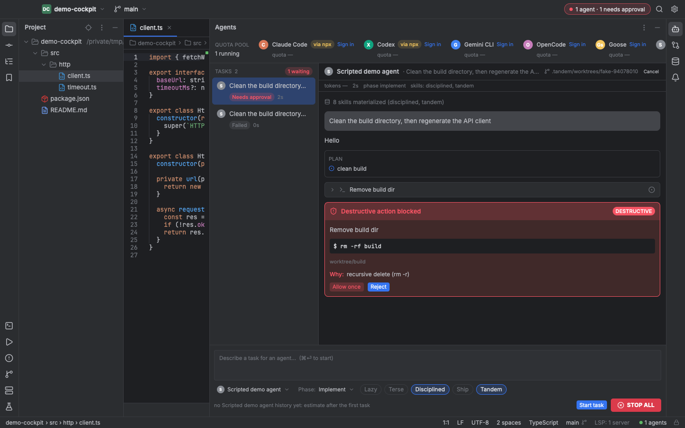
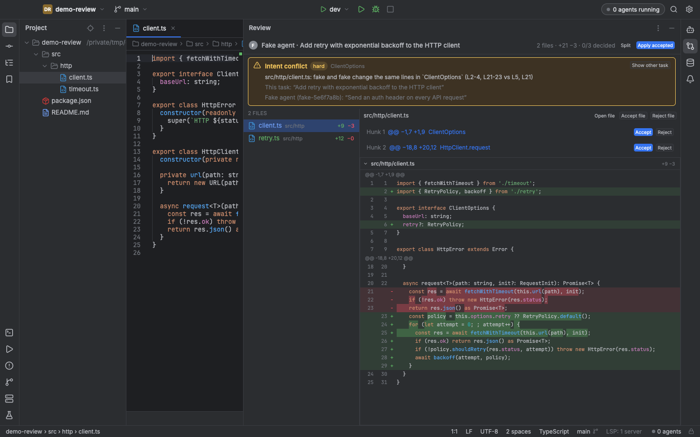
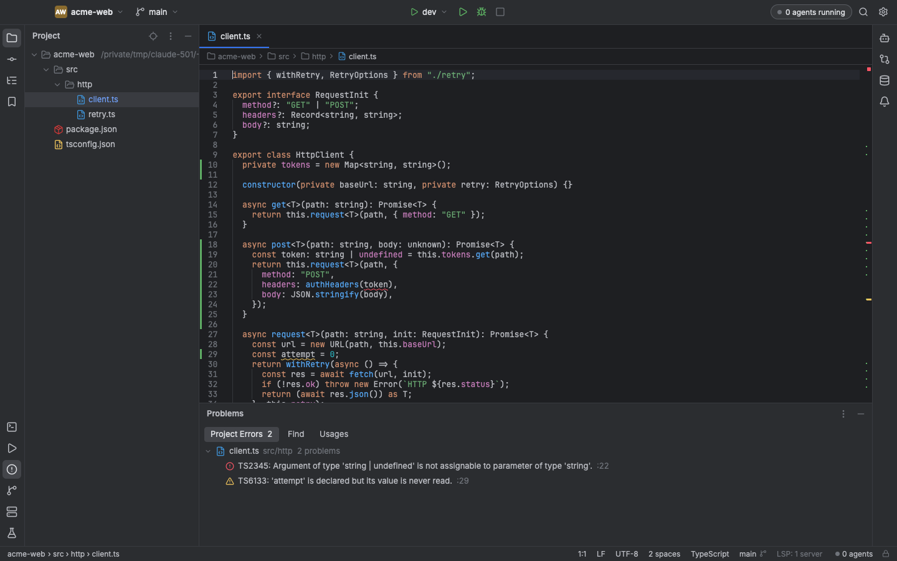
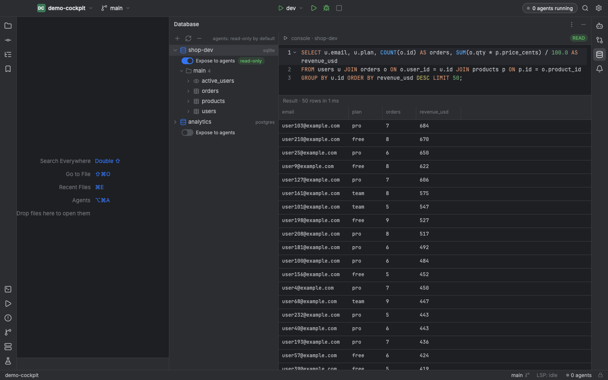

<div align="center">


# Tandem

**The native IDE for working with coding agents.**<br>
Run Claude Code, Codex, Gemini CLI, OpenCode and Goose side by side on the subscriptions you already pay for, and keep every one of them on a leash.

[](https://github.com/mintunitish/tandem/releases/latest)
[](LICENSE)
[](https://github.com/mintunitish/tandem/releases/latest)
[](rust-toolchain.toml)

[**Download for macOS**](https://github.com/mintunitish/tandem/releases/latest) · [Design spec](docs/specs/2026-10-24-tandem-design.md) · [Research](docs/research/) · [Packaging](docs/PACKAGING.md)


</div>

---

## Why Tandem

Agents write most of the diff now. The editor has not caught up. You juggle terminals, hit rate limits on one subscription while two others sit idle, and hope that nobody runs `rm -rf` on the wrong directory.

Tandem is an IDE built around that reality. Agents are first-class tenants, not a chat sidebar.

- **One pool for every subscription.** A single quota gauge across Claude Max, ChatGPT, Gemini, Copilot and API keys. The router sends each task to the agent with headroom, or you pin one.
- **A kill switch that is real.** Each agent runs env-scrubbed, in its own process group, under a macOS Seatbelt profile. Destructive commands stop at a red approval card. One button stops everything.
- **Review like a diff tool, not a chat log.** Every task works in its own git worktree. Accept or reject per hunk. Tandem warns when two parallel agents edit the same lines or symbols.
- **Know who wrote what.** Agent blame traces a hunk to the agent, the prompt and the permission click. Every task keeps a replayable event log.
- **Measure your agents on your repo.** A built-in harness runs conformance scenarios and benchmark tasks against every installed agent, then prints a leaderboard.
- **Native and local.** Rust and GPU-rendered UI. No Electron, no web view, no telemetry, no model gateway, no account.

## Your agents, unmodified

Tandem speaks the open [Agent Client Protocol](https://agentclientprotocol.com). Agents run as the vendor's own binary and log in the way the vendor intended. Tandem never reads your credentials and never sits between you and a model provider.

| Agent | How it connects |
|---|---|
| Claude Code | `claude-agent-acp` adapter or the stock `claude` binary |
| Codex | `codex-acp` adapter |
| Gemini CLI | `gemini --acp` |
| OpenCode | `opencode acp` |
| Goose | `goose acp` |
| Any ACP agent | Add a descriptor, no code changes |

## Tour

<table>
<tr>
<td width="50%"><br><sub><b>Cockpit.</b> Parallel tasks, quota pool, skill toggles and a red card for destructive actions.</sub></td>
<td width="50%"><br><sub><b>Review.</b> Per-hunk accept or reject, with intent-conflict warnings across tasks.</sub></td>
</tr>
<tr>
<td width="50%"><br><sub><b>Editor.</b> Tree-sitter highlighting and language servers for completion, hover and diagnostics.</sub></td>
<td width="50%"><br><sub><b>Database.</b> Postgres, MySQL and SQLite. Agents get a read-only MCP view by default.</sub></td>
</tr>
</table>

<sub>Screenshots use a scripted demo agent so the safety cards are reproducible.</sub>

## Features

**Agent cockpit**
- Run any number of agents in parallel, one git worktree per task under `.tandem/worktrees/`.
- Live token and cost meter, per-agent history for pre-prompt estimates, phase-based routing (plan, implement, test).
- Replayable per-task log at `.tandem/tasks/<id>/log.jsonl`.

**Safety runtime**
- Seatbelt sandbox per agent: no reads of `~/.ssh`, `~/.aws`, `~/.gnupg`, no writes outside the worktree.
- Environment scrubbing: agents inherit only what they need.
- Destructive-command classifier covering `rm -r`, `git push --force`, `git reset --hard`, `DROP`, `TRUNCATE`, `curl | sh` and writes to secret paths.
- MCP servers exposed to agents are hash-pinned at first use. A changed server needs fresh approval.
- Project files under `.tandem/` are treated as untrusted until you approve them.

**Skill packs**
- superpowers, ponytail, caveman and gstack ship in the box, plus Tandem's own review, db-safety and harness skills.
- Toggle a pack per task and Tandem materializes it into the worktree for every agent (`.claude/skills/`, `.codex/skills/`, `.agents/skills/`, plus an `AGENTS.md` index).
- Licenses are tracked in [`skills/LICENSES.md`](skills/LICENSES.md).

**Editor and tools**
- Project tree, tabs, Search Everywhere, global search, integrated terminal, git panel.
- LSP for TypeScript, Python, Rust and Go servers.
- Dark and light themes, macOS keymap.

**Harness**
- 11 conformance scenarios: permission gating, sandbox escapes, secret reads, cancellation, structured diffs.
- 5 benchmark tasks across Rust, Python, TypeScript, SQL and refactoring, scored on pass rate, time and tokens.
- Output is JSON plus a markdown report, ready to share.

```sh
cargo run -p tandem-harness -- conformance --runner acp --agents auto --scenario-dir harness/scenarios
```

## Install

Download the latest DMG from [Releases](https://github.com/mintunitish/tandem/releases/latest), drag **Tandem** to Applications and launch it.

> **First launch.** The v0.1.0 build is ad-hoc signed and not yet notarized. On first open, right-click Tandem, choose **Open**, then **Open** again. Or run `xattr -dr com.apple.quarantine /Applications/Tandem.app`.

Requirements: macOS 14 or newer, Apple Silicon. Install at least one agent CLI, for example `npm i -g @anthropic-ai/claude-code` or the Codex CLI.

## Build from source

```sh
rustup toolchain install stable
git clone https://github.com/mintunitish/tandem && cd tandem
cargo run -p tandem-app -- /path/to/project     # run the IDE
cargo test --workspace                          # run the tests
scripts/build-dmg.sh                            # package a DMG, see docs/PACKAGING.md
```

## Architecture

A Cargo workspace. Backend crates depend only on `tandem-core`, so every one of them runs headless and is tested without the UI.

| Crate | Role |
|---|---|
| `tandem-core` | Shared types, event bus, settings |
| `tandem-acp` | ACP client, agent registry, permission requests |
| `tandem-sandbox` | Seatbelt profiles, env scrubbing, destructive-command classifier |
| `tandem-quota` | Quota pool and router, from each agent's own usage signals |
| `tandem-review` | Diff model, hunk apply, intent-conflict detection |
| `tandem-git` | Status, diff, commit, worktrees |
| `tandem-lsp` | Language server manager |
| `tandem-project` | File tree, watcher, search, symbol index |
| `tandem-terminal` | PTY and terminal grid |
| `tandem-db` | Connections, schema, queries, read-only MCP server |
| `tandem-skills` | Skill pack loader and materializer |
| `tandem-harness` | Conformance and benchmark CLI |
| `tandem-app` | The gpui-kit application |

Read the full [design spec](docs/specs/2026-10-24-tandem-design.md).

## Status

Tandem v0.1.0 is the first public build. It is usable, and it has rough edges. The [conformance report](docs/research/2026-10-24-conformance-report.md) records exactly how each agent behaved under the sandbox, including the failures.

Known gaps in v0.1:
- Claude Code cannot yet run inside Tandem's Seatbelt profile because it logs in through the macOS keychain. A vendored sandbox is planned.
- The database MCP server is not attached to sandboxed tasks yet. An IDE-hosted server with a socket proxy is planned.
- Long transcripts are not virtualized.

Roadmap: intent-conflict radar UI, debugger, IDE-hosted MCP, Developer ID signing and notarization, Linux and Windows builds.

## Contributing

Issues and pull requests are welcome. Run `cargo test --workspace` before you send a change. If you add an agent, add its conformance run to the harness report.

## License

Apache-2.0, see [LICENSE](LICENSE). Bundled skill packs keep their own licenses.
