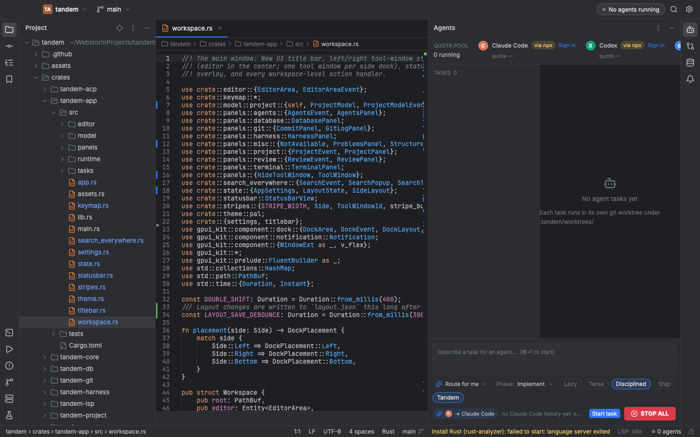

# Tandem

Native macOS IDE for developers who work with coding agents. Looks and feels like WebStorm. Runs Claude Code, Codex, Gemini CLI, OpenCode, Goose and any Agent Client Protocol (ACP) agent as the vendor's unmodified binary, on your own subscription, inside a cockpit that gates what they can do.



## Why

- **Not a VS Code fork.** Rust + gpui (Zed's GPU UI layer) via gpui-kit. No Electron, no web view.
- **Your subscriptions, one pool.** Quota gauge across Claude Max, ChatGPT, Gemini, Copilot and API keys; router picks the agent with headroom.
- **Kill switch.** Every agent runs env-scrubbed, in its own process group, under a Seatbelt profile; destructive commands never auto-run; one STOP ALL.
- **Diff-centric review.** Per-task worktrees, accept/reject per hunk, intent-conflict detection across parallel agents, agent blame in the gutter.
- **Harness.** Conformance scenarios and a benchmark leaderboard you can run on your own repo against every installed agent.
- **Built-in skill packs.** superpowers, ponytail, caveman, gstack and Tandem's own, materialized into each task worktree.

## Status

v0.1 in progress (2026-10). Backend crates complete and tested; UI shell runs; wiring in progress. See `docs/specs/2026-10-24-tandem-design.md` and `docs/research/`.

## Build

```sh
rustup toolchain install stable
cargo run -p tandem-app -- /path/to/project
cargo test --workspace
cargo run -p tandem-harness -- conformance --runner acp --agents auto --scenario-dir harness/scenarios
```

## Layout

`crates/tandem-core` shared types · `tandem-acp` agent client · `tandem-sandbox` safety runtime · `tandem-quota` quota pool + router · `tandem-git` · `tandem-review` · `tandem-lsp` · `tandem-project` · `tandem-terminal` · `tandem-db` (+ `tandem-db-mcp`) · `tandem-skills` · `tandem-harness` · `tandem-app` (gpui-kit UI).

## License

Apache-2.0. Bundled skill packs keep their own licenses, see `skills/LICENSES.md`.
